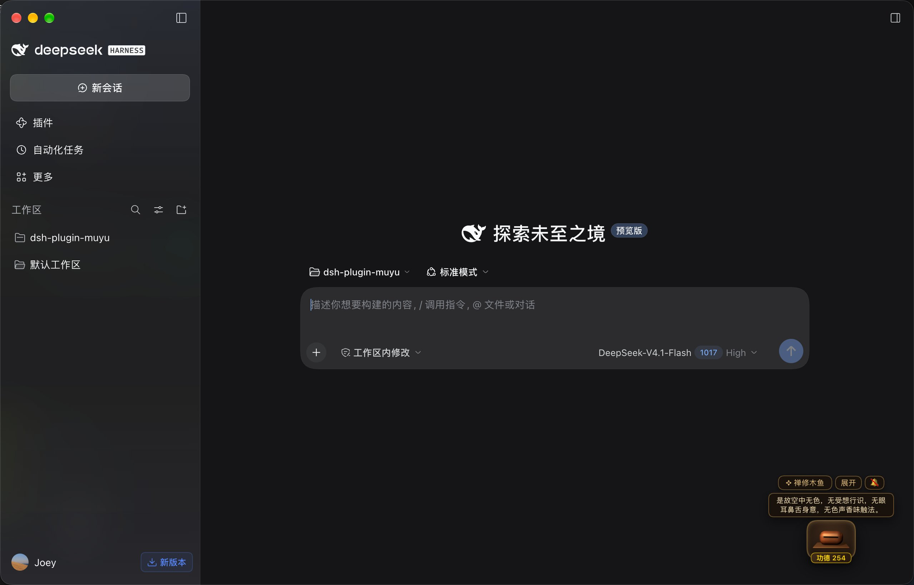
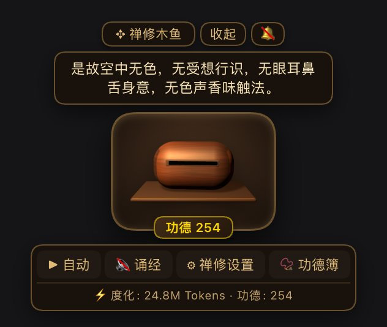

# dsh-plugin-muyu (DeepSeek Harness 电子木鱼与禅修诵经插件)

基于 [DeepSeek Harness 插件开发规范](https://deepseek-harness.github.io/deepseek-harness/develop/basic/) 与 [Cordis 架构指南](https://deepseek-harness.github.io/deepseek-harness/develop/cordis-tutorial/) 构建的跨平台电子木鱼诵经与 Token 功德修持插件（Bundle）。

提供 3D 木鱼敲击挂件、8 部传世经文逐句流转、跨平台粤语/普通话诵经语音合成、三种物理音色（紫檀沉音、清脆白木、古刹清磬）、会话 Token 自动度化功德与按日持久化功德簿。

## 📸 效果展示

**工作区悬浮挂件**：会话界面右下角常驻，可与工作区对话同时修持，功德与 Token 度化实时同步服务端账本。



**展开后的修持面板**：3D 木鱼、逐句流转的经文气泡、功德计数，以及「自动修持 / 诵经开关 / 禅修设置 / 功德簿」工具栏。



---

## 🌟 核心特性

1. **会话 Token 自动度化功德（Token-to-Merit Engine）**：
   - 服务端监听 DSH 原生 `session/event` 中的 `assistant/message` 消息 `usage`（自动汇总 `inputTokens + outputTokens + cacheReadTokens + cacheWriteTokens`，忽略 `assistant/attempt` 重试以免重复记账）。
   - 默认每累计消耗 `10,000 Tokens` 自动敲响木鱼 1 次、功德 `+1`；未满阈值的余数持久化保存在 `pendingTokens` 缓冲池中，跨宿主重启不丢失。
   - 单次大额 Token 突增采用批量单次原子写盘；真实 `session/event` 用量**完整记入** `todayTokens`/`totalTokens`，只把单次敲击封顶在 `108` 敲，超出的整 step 不进入 pending 队列。
   - 只有手动补记工具 `muyu_feed_tokens` 会在输入侧封顶，避免一次异常调用留下巨大积压。
   - 前端挂件轮询同一份服务端账本：Token 度化会实时触发木鱼敲击动画、音效与功德累积，不再依赖客户端本地记账。
   - 点击木鱼时，经文气泡会在当前句诵完后才推进到下一句，不会在点击瞬间跳句。
   - Token 显示采用紧凑单位：不足 1M 用 `k`，达到 1M 用 `M`，达到 **108M 显示 `1圆满`**（例如 `12k`、`1.2M`、`29.6M`、`1圆满`、`2圆满`）。
   - 功德显示使用千分逗号（`1,234`）；功德允许为负数（扣功德模式下显示 `-1,234`）。
   - 设置面板新增 **⚡ Token** 页，可直接调整「每多少 Token 增加 1 功德」；输入负数进入**扣功德趣味模式**（每 |N| Token 扣 1 功德），设置持久化到 `.state.json`。
2. **传世经文经典宝库（客户端与服务端共享唯一权威源）**：
   - 内置《般若波罗蜜多心经》（玄奘译本 14 句）、《金刚般若波罗蜜经》、《大悲心陀罗尼神咒》、《六字真言与禅林名偈》、《药师灌顶真言》、《准提神咒》、《往生咒》、《楞严咒心赞偈》。
3. **三种木鱼与古刹清磬音色 + 独立静音**：
   - `sandalwood`：紫檀沉音（浑厚沉稳，声如古庙老木，定心凝神）
   - `whitewood`：清脆白木（轻盈通透，高频脆爽，提神醒脑）
   - `bell`：古刹清磬（悠扬致远，梵音泛音列谐振，余音绕梁）
   - 顶部 `🔔 / 🔕` 可独立静音木鱼敲击音效（不影响诵经语音）；工具栏 `🔊 诵经 / 🔇 诵经` 单独控制语音，两者互不干扰。
4. **跨平台自然诵经语音（粤语女声优先）**：
   - 自动识别系统粤语女声（`zh-HK` / `yue` / Sinji）或普通话女声，动态跟随所选发音人的真实语种标签（`voice.lang`）。
5. **原子化功德簿持久化**：
   - 按路径优先级 `显式 storagePath > $DSH_HOME/muyu-data/merit_history.json > ~/.dsh/muyu-data/merit_history.json` 存储。
   - 采用 `*.tmp` + `renameSync` 原子写盘；若遇到意外损坏的 JSON 文件，自动隔离备份为 `.corrupt-<timestamp>`，保障历史数据安全。
   - 每次写账本前先获取 `<merit_history.json>.lock` 独占锁，再重读磁盘账本、只应用本次增量并原子回写；桌面端与 `dsh web` 同时运行也不会互相覆盖。
   - 锁文件记录 pid/token；持锁进程已退出会按 pid 判定并安全接管，存活进程持锁时 250ms 后放弃本次写入（抛 `MeritStorageBusyError`），绝不无锁覆盖。
   - 历史遗留或调小 `tokensPerMerit` 后 >= 1 step 的 pending 会在启动时折算成最多 108 点功德，余数保留，不再静默截断。
   - 当前经文、句序与音色持久化到 `<merit_history.json>.state.json`，宿主重启后自动恢复。挂件内的选择优先于配置默认值；需要让 `defaultSutra`/`defaultSound` 重新生效时，将 `resetRuntimeState` 设为 `true` 启动一次。

---

## 📊 单一账本与配置说明

当前版本只维护**一本服务端功德簿**（`~/.dsh/muyu-data/merit_history.json`），不存在客户端独立账本：
- `session/event` 自动计量的 Token 功德、`muyu_knock` / `muyu_auto_knock` / `muyu_feed_tokens` 工具产生的功德，以及悬浮挂件的手敲/自动修持，全部写入同一份账本，可通过 `muyu_get_merit` 查询。
- 挂件启动时读取 `GET /dsh-muyu/state`，之后每 800ms 轮询一次；发现功德增长就触发敲击动画、音效与诵经。手敲、自动修持、切换经文分别 POST 到 `/dsh-muyu/knock`、`/dsh-muyu/auto`、`/dsh-muyu/sutra`，由服务端统一写入。
- 旧版浏览器 `localStorage['dsh_muyu_client_merit']` 会在挂件加载时自动清除，历史本机功德不再参与展示。
- `session/event` 的真实 Token 用量不做输入截断；`muyu_feed_tokens` 单次最多接受 `108 × abs(tokensPerMerit)` Tokens（默认 1,080,000），超出部分直接忽略，避免留下需要几十万次调用才能消化的 `pendingTokens` 积压。

### 挂件使用的 Host API

| 路由 | 方法 | 说明 |
|---|---|---|
| `/dsh-muyu/state` | `GET` | 返回今日/累计功德、今日/累计 Token、`pendingTokens`、当前经文、`lastSentence`、`chantSeq`、自动修持状态；`?history=1` 时附带按日明细 |
| `/dsh-muyu/knock` | `POST` | 手敲一次（`{ count }`，1~108），写入服务端账本并返回新状态 |
| `/dsh-muyu/auto` | `POST` | 开始/停止/查询服务端自动修持（`{ action: 'start' \| 'stop' \| 'status' }`） |
| `/dsh-muyu/sutra` | `POST` | 切换服务端当前经文（`{ bookId }`） |
| `/dsh-muyu/tokens-per-merit` | `POST` | 调整 Token 功德阈值（`{ value }`，非零整数，范围 ±10,000,000；负数 = 扣功德） |

这些路由由 `dsh-host-webserver` 挂在 loopback 的同一 Web 服务上，仅供页面内的挂件调用：
- `POST` 必须使用 `content-type: application/json`，否则返回 415；跨域 `text/plain` 简单请求会被直接拒绝。
- 所有路由校验 `Host` 与 `Origin`：只允许本机 Web 源、`dsh-app://app` 或同端口 loopback 源；其他来源返回 403。识别不到宿主 origin（旧版/异构宿主 API）时记录一次明确警告并回退为 loopback-only 校验，挂件不会整体失效。
- 请求体上限 8 KiB；`cycleTitle` 最长 80 字符，`bookId` 最长 64 字符。
- 修改 Host 端路由后需要重启 DSH 宿主，前端 bundle 可通过页面刷新/HMR 重新加载。

### 配置项矩阵 (`cordis.patch.yml`)

| 配置项 | 类型与默认值 | 作用域 | 说明 |
|---|---|---|---|
| `defaultSutra` | `string` (`'heart_sutra'`) | 服务端 | 服务端初始诵读经文 ID（挂件切换经文也会写入服务端） |
| `defaultSound` | `'sandalwood' \| 'whitewood' \| 'bell'` | 服务端 | 服务端默认音色（挂件端另有本地音色选择，用于浏览器播放） |
| `autoKnockIntervalMs` | `number` (`1200`, 范围 `200~60000`) | 服务端 | 自动修持默认敲击间隔毫秒数 |
| `autoKnockMaxDurationMs` | `number` (`1800000`, 默认 30 分钟) | 服务端 | 无尽修持单次最大持续时长，到时自动停止 |
| `voiceEnabled` | `boolean` (`true`) | 服务端 | 服务端语音提示开关（挂件端另有本地“诵经: 开/静音”偏好） |
| `voiceRate` | `number` (`0.8`, 范围 `0.1~2.0`) | 服务端 | 服务端返回 `voicePrompt.rate` 语速参数 |
| `voicePitch` | `number` (`0.95`, 范围 `0.1~2.0`) | 服务端 | 服务端返回 `voicePrompt.pitch` 音调参数 |
| `volume` | `number` (`1.0`, 范围 `0.0~1.0`) | 服务端 | 服务端返回 `voicePrompt.volume` 音量参数 |
| `storagePath` | `string` (可选，支持 `~`) | 服务端 | 自定义功德簿 JSON 存储路径 |
| `tokenKnockEnabled` | `boolean` (`true`) | 服务端 | 是否开启按会话 Token 消耗自动敲木鱼攒功德 |
| `tokensPerMerit` | `number` (`10000`) | 服务端 | 每多少 Token 增加 1 功德；负数表示每 abs(N) Token 扣 1 功德（可在挂件 ⚡ Token 页调整，运行时覆盖配置） |
| `resetRuntimeState` | `boolean` (`false`) | 服务端 | 启动时清除 `.state.json`，让 `defaultSutra`/`defaultSound` 重新生效（一次性重置） |

---

## 🛠️ 注册的 6 个 DSH Tools

| 工具名称 | 功能描述 |
|---|---|
| `muyu_knock` | 敲击木鱼积攒服务端功德（`count` 范围 1~108，每次调用推进 1 句经文诵念），返回当前经文与音效信息 |
| `muyu_auto_knock` | 启动（`start`）、停止（`stop`）或查询（`status`）自动敲木鱼任务，支持 0/9/21/49/108/1080 周期与超时保护 |
| `muyu_get_merit` | 查看服务端今日功德、历劫总功德、今日/历劫度化 Token、蓄力余数 `pendingTokens` 及按日明细 |
| `muyu_select_sutra` | 浏览 8 部经典目录摘要或切换当前诵读修持的经典经咒 |
| `muyu_play_sound` | 获取或切换紫檀沉音、清脆白木、古刹清磬音色 |
| `muyu_feed_tokens` | 外部或手动补记 Token 消耗量（日常对话已由 `session/event` 自动计量）；单次最多 `108 × abs(tokensPerMerit)` Tokens，超出忽略；负阈值时扣功德 |

---

## 📦 安装、构建与测试

### 1. 构建与测试

```sh
npm run build   # 从 src/ 编译生成 lib/**/*.js、.d.ts 以及浏览器单文件包 lib/client.js
npm test        # 自动执行 pretest 构建并运行全部单元测试
```

构建脚本优先使用 `$TSC`、本地或上级 `node_modules/.bin/tsc`；都没有时回退到 Node 的 `stripTypeScriptTypes`（实验性，生成 JS 与客户端 bundle，但不会刷新 `.d.ts`）。CI 中 `npm install` 会安装本地 `typescript`，因此正常走完整 `tsc`。

### 2. 在 DeepSeek Harness 中加载

可通过 `--patch` 载入 `cordis.patch.yml`，或在 DSH Desktop 的 Profile（如 `~/.dsh/profiles/desktop`）中通过 Plugin Manager / `pnpm` 链接安装本目录：

```sh
pnpm dsh web --patch ./dsh-plugin-muyu/cordis.patch.yml
```

> 更新 Host 端代码（`src/index.ts`、`src/services/*`）后需要重启 DSH 宿主，`/dsh-muyu/*` 路由才会注册；只改前端 bundle 时刷新页面/HMR 即可。
